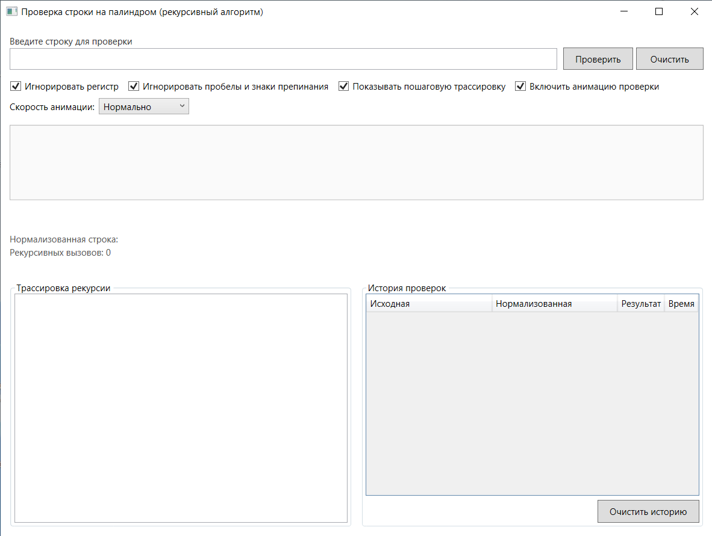
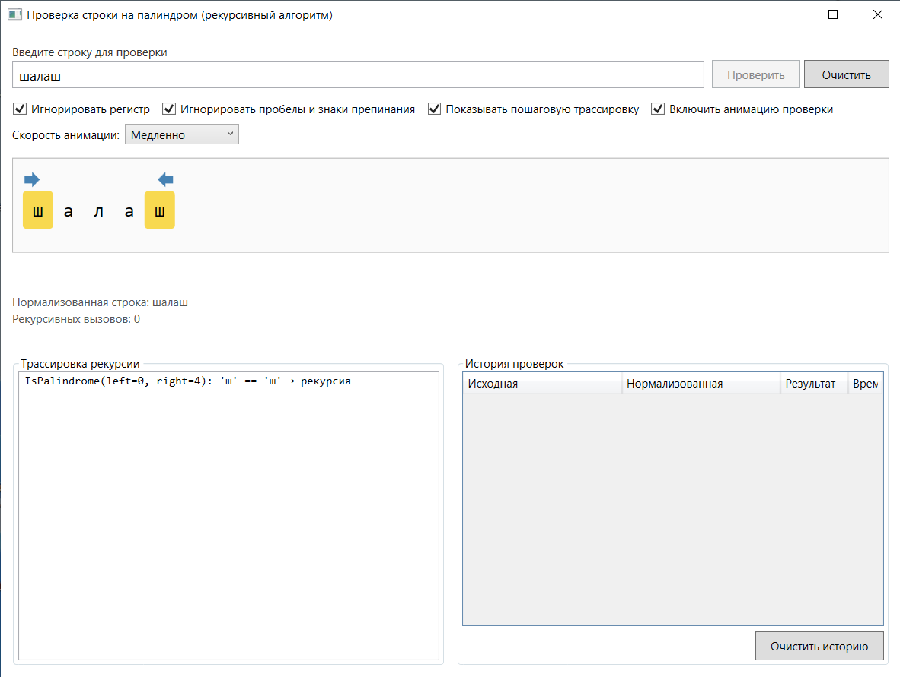
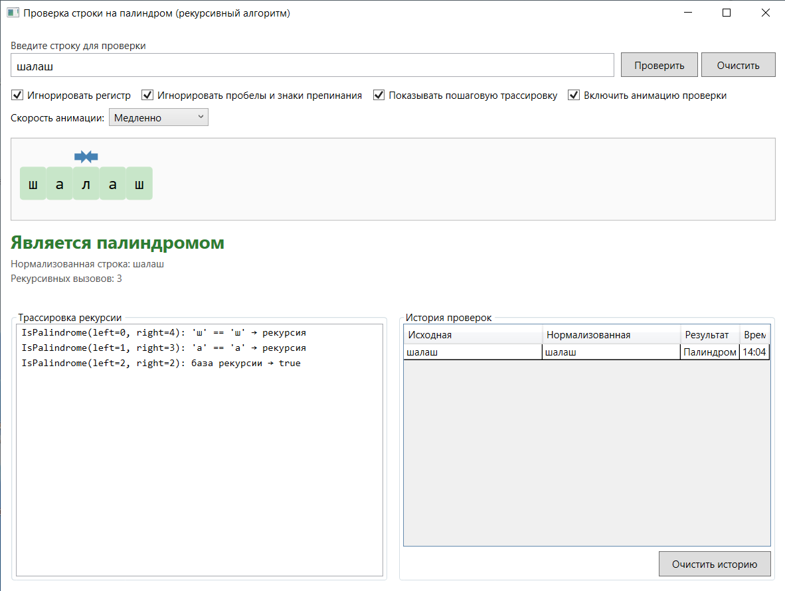

Учебно-демонстрационное WPF-приложение на **.NET 8**, наглядно показывающее работу **рекурсивного алгоритма** проверки строки на палиндром с плавной анимацией подсветки символов и стрелок-указателей.

---

## ✨ Возможности

- 🔁 **Рекурсивный алгоритм** `IsPalindrome` — без библиотечных однострочников
- 🎨 **Плавная анимация** подсветки сравниваемых символов (жёлтый → зелёный/красный)
- ➡️⬅️ **Стрелки-указатели**, сходящиеся к центру по мере рекурсии
- 🐢🐇 **Настраиваемая скорость** анимации (медленно / нормально / быстро)
- 📋 **Пошаговая трассировка** рекурсии в отдельной панели
- ⚙️ **Гибкая проверка**: игнорирование регистра, пробелов и знаков препинания
- 🕘 **История проверок** (последние 10)

---

## 🚀 Быстрый старт

### Требования

- Windows 10/11
- [.NET 8 SDK](https://dotnet.microsoft.com/download/dotnet/8.0)
- Visual Studio 2022 (17.8+) **или** JetBrains Rider

### Сборка и запуск
Откройте `PalindromDemo.sln` в Visual Studio и нажмите **F5**.

---

## 🧠 Как это работает

### Рекурсивный алгоритм

```csharp
private async Task<bool> CheckRecursiveAsync(string s, int left, int right, ...)
{
    if (left >= right) return true;           // база рекурсии
    if (s[left] != s[right]) return false;    // несовпадение
    return await CheckRecursiveAsync(s, left + 1, right - 1, ...);
}
```

### Анимация в WPF

- **Подсветка** — `DataTrigger` по `CharViewModel.State` + `ColorAnimation` (декларативно, без кода в code-behind)
- **Стрелки** — `DoubleAnimation` с `CubicEase` на `Canvas.Left`, синхронизировано с рекурсией через `INotifyPropertyChanged`

---

## 🗂️ Структура проекта

```
src/PalindromDemo/
├── Views/             MainWindow.xaml
├── ViewModels/        MainViewModel, CharViewModel
├── Models/            CheckStep, TraceEntry, HistoryEntry
├── Services/          PalindromeChecker, PalindromeAnimator, StringNormalizer
├── Controls/          PalindromeVisualizer
└── Resources/         Theme.xaml
```

---

## 📸 Скриншоты

| Главное окно | Анимация шага | Результат |
|:---:|:---:|:---:|
|  |  |  |

---
